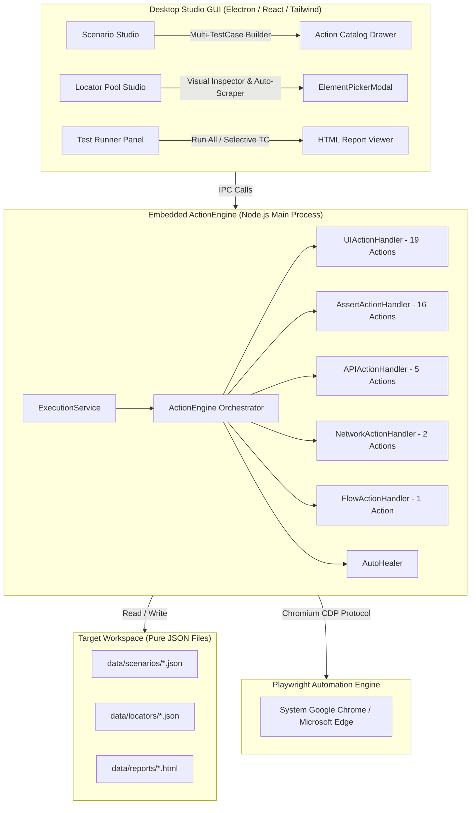

# Playwright Embedded Desktop Studio

> **An enterprise-grade, standalone Windows Desktop Studio powered by Playwright and the `swag-labs-hybrid` core engine.**  
> Zero dependencies required for end users. No Node.js, npm, or Git installation needed.

[](https://microsoft.com/windows)
[](https://playwright.dev/)
[](./reports/v1.2.0-action-parity-locator-binding-and-scraper.md)
[](./dist-release/win-unpacked/)

---

## 📖 Overview

**Playwright Embedded Desktop Studio** bridges the gap between technical SDET test engineering and non-technical QA testers. It packages a full-fledged Playwright automation engine, Action Handlers, Locator Pools, Data-Driven Testing (DDT), and HTML reporting inside a single, high-performance desktop application.

Workspaces created in Playwright Desktop Studio **only contain pure JSON files** (`data/scenarios/*.json` and `data/locators/*.json`). There are no `node_modules`, no `package.json`, and no compilation steps for test creators.

---

## 🌟 Key Features

### 1. 🎯 Full 43 Actions Parity (100% Core Coverage)
Achieves full parity with the `swag-labs-hybrid` engine across all five operational categories:
- **UI Actions (19)**: `goto`, `click`, `left_click`, `right_click`, `double_click`, `hover`, `fill`, `clear`, `press_key`, `select_option`, `check`, `uncheck`, `upload_file`, `scroll_to`, `wait`, `wait_for_element`, `switch_new_tab`, `store_text`, `save_storage_state`.
- **Assertions (16)**: `verify_visible`, `verify_not_visible`, `verify_enabled`, `verify_disabled`, `verify_checked`, `verify_unchecked`, `verify_value`, `verify_text`, `verify_text_contains`, `verify_not_contains_text`, `verify_class_contains`, `verify_not_contains_class`, `verify_url_contains`, `verify_attribute`, `verify_element_count`, `verify_visual_snapshot`.
- **API Actions (5)**: `api_get`, `api_post`, `api_put`, `api_patch`, `api_delete`.
- **Network Actions (2)**: `mock_route`, `unmock_route` (intercept and stub network requests).
- **Flow Control (1)**: `call_flow` (execute reusable sub-flow scenarios).

### 2. 🖱️ Live Web Inspector & 1-Click Auto-Scraper (For Non-Tech Users)
Non-technical users no longer need to open Chrome DevTools or inspect HTML tags:
- **🎯 Live Click & Pick**: Opens any target website with an embedded interactive overlay. Point and click any element to capture its optimal selector (`data-test`, `data-testid`, `#id`, or CSS path) with automated camelCase naming (e.g. `loginBtn`, `usernameInput`).
- **⚡ 1-Click Auto-Scrape**: Scrapes all interactive elements (buttons, inputs, links, dropdowns) on an entire web page in seconds and imports them directly into your Page Object.

### 3. 🔒 Strict Locator Repository Binding Constraint
- Scenarios are explicitly bound to a dedicated locator repository (`scenario.config.locatorFile`).
- Elements and Pages are strictly scoped to prevent cross-file selector pollution.
- Guard rails prevent non-tech users from configuring element-driven steps until a locator repository is selected, with an amber banner and locked fields.

### 4. 🧪 Multi-TestCase Isolation & Selective Re-Testing
- Scenarios are organized into independent test cases (`TC_01`, `TC_02`, etc.) with preconditions, core steps, and postconditions.
- Each test case executes in an isolated `BrowserContext` with fresh cookies, storage, and sessions.
- Users can run individual test cases (e.g., **"Run TC_01"**) or select a subset of test cases to re-test without rerunning the entire suite.

### 5. 📊 Data-Driven Testing (DDT) & Self-Healing Locators
- Built-in Excel-like Data Table editor for parameterized test executions.
- **AutoHealer**: Automatically identifies broken selectors during runtime using Playwright AI heuristics and patches the locator repository file.

### 6. 📄 Standalone HTML Execution Reports
- Produces self-contained HTML test reports with summary dashboards, step execution breakdown, execution duration, and failure screenshots.

---

## 🏗️ Architecture



---

## 📁 Workspace Structure

When you select a test project folder, the studio reads and manages pure JSON files structured as follows:

```text
my-test-project/
├── data/
│   ├── scenarios/
│   │   ├── swag-lab-scenarios.json   # Test suite with multiple test cases
│   │   └── api-scenarios.json        # REST API test cases
│   ├── locators/
│   │   ├── swag-labs-locators.json   # Page Objects with clean string selectors
│   │   └── common-locators.json      # Shared header, footer, navigation elements
│   └── reports/
│       ├── test_report.html          # Latest generated standalone HTML report
│       └── screenshots/              # Failure screenshots
```

### Scenario JSON Format (`data/scenarios/*.json`)
```json
{
  "name": "Swag Labs End-to-End Suite",
  "description": "Comprehensive regression suite",
  "tags": ["@smoke", "@regression"],
  "config": {
    "locatorFile": "swag-labs-locators.json"
  },
  "testCases": [
    {
      "testId": "TC_01",
      "testName": "Valid Login",
      "steps": [
        { "action": "goto", "url": "https://www.saucedemo.com/" },
        { "action": "fill", "page": "LoginPage", "element": "usernameInput", "data": "standard_user" },
        { "action": "fill", "page": "LoginPage", "element": "passwordInput", "data": "secret_sauce" },
        { "action": "click", "page": "LoginPage", "element": "loginBtn" },
        { "action": "verify_visible", "page": "InventoryPage", "element": "inventoryContainer" }
      ]
    }
  ]
}
```

### Locator JSON Format (`data/locators/*.json`)
```json
{
  "LoginPage": {
    "usernameInput": "input[data-test=\"username\"]",
    "passwordInput": "input[data-test=\"password\"]",
    "loginBtn": "input[data-test=\"login-button\"]"
  },
  "InventoryPage": {
    "inventoryContainer": ".inventory_container",
    "shoppingCartBadge": ".shopping_cart_badge"
  }
}
```

---

## 🚀 User Guides

### Guide for Non-Tech Testers
1. **Launch the Studio**: Run `Playwright Embedded Studio.exe` (no installation required).
2. **Open Workspace**: Click **"Open Folder"** and select your test project directory.
3. **Inspect & Scrape Elements**:
   - Open **Locator Pool Studio** from the top navigation.
   - Click **"Pick & Scrape Web"** in the header.
   - Enter your website URL (e.g. `https://www.saucedemo.com/`).
   - Use **"🎯 Live Click & Pick"** to click elements on the page, or click **"⚡ Scrape All Elements"** to grab all inputs and buttons automatically.
   - Select the target Page Object (e.g. `LoginPage`) and click **"Import Selected Elements"**.
4. **Create or Edit Scenarios**:
   - Open **Scenario Studio**.
   - Select your **Bound Locator Repository** dropdown in the header card.
   - Click **"Action Catalog"** to drag-and-drop or select actions (`goto`, `fill`, `click`, `verify_visible`).
   - Select Page and Element from the auto-suggested dropdowns.
5. **Run & View Results**:
   - Click **"Run TC_01"** or **"Run All"**.
   - Watch the live step execution in the **Test Runner Panel**.
   - Click **"View HTML Report"** to open the report in your browser.

---

## 🛠️ Developer & Build Instructions

### Prerequisites (For Developers Building From Source)
- Node.js 20+ (x64)
- npm 10+
- Windows 10/11 x64

### 1. Install Dependencies
```bash
npm install
```

### 2. Run in Development Mode
```bash
npm run dev
```

### 3. Type Checking
```bash
npm run typecheck
```

### 4. Build Portable Unpacked Distribution
> [!IMPORTANT]  
> Always terminate any running instance of the studio prior to building:
```bash
powershell -ExecutionPolicy Bypass -File scripts/kill-studio.ps1
npm run build:dir
```

### 5. Sign Portable Executable
To prevent Windows SmartScreen publisher warnings:
```bash
powershell -ExecutionPolicy Bypass -File scripts/sign-exe.ps1
powershell -Command "Unblock-File -Path 'dist-release\win-unpacked\Playwright Embedded Studio.exe'"
```

The output executable will be available at:
```text
dist-release/win-unpacked/Playwright Embedded Studio.exe
```

---

## 📚 Version History & Reports

Detailed technical implementation reports and changelogs for each version are maintained in the [`reports/`](./reports/) directory:

- 📄 [**Changelog Index**](./reports/CHANGELOG.md)
- 📄 [**v1.2.0 Report**](./reports/v1.2.0-action-parity-locator-binding-and-scraper.md): 43 Actions Parity, Strict Locator Binding & Web Scraper
- 📄 [**v1.1.0 Report**](./reports/v1.1.0-workspace-and-multitestcase.md): Multi-TestCase Isolation, Selective Re-Testing & SmartScreen Signing
- 📄 [**v1.0.0 Report**](./reports/v1.0.0-initial-portable.md): Initial Embedded Desktop Studio Packaging

---

## 📄 License

MIT License. Built with ❤️ for QA Engineers, SDETs, and Test Automation Teams.
"# SpecDesk" 
