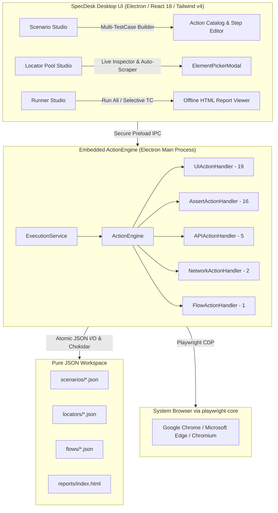

# SpecDesk

> **Standalone Low-Code Playwright Test Automation Desktop Studio.**  
> Zero prerequisites for end users — no Node.js, npm, or Git required. Manage and execute full test suites directly from pure JSON workspaces.

[](https://microsoft.com/windows)
[](https://playwright.dev/)
[](./docs/releases/v1.2.0-action-parity-locator-binding-and-scraper.md)
[](#license)

---

## Overview

**SpecDesk** bridges technical SDET automation architecture and non-technical QA testing. It embeds `playwright-core`, a 43-action execution engine, Page Object Locator Pools, a Live Web Inspector & Auto-Scraper, Data-Driven Testing (DDT) tables, and standalone offline HTML reporting inside a single desktop application.

Workspaces opened in SpecDesk **only contain pure JSON files** (`scenarios/`, `locators/`, `flows/`). Target test repositories never need `node_modules`, `package.json`, or compilation steps.

---

## Key Features

### 1. 43 Built-in Automation Actions
- **UI Actions (19):** `goto`, `click`, `left_click`, `right_click`, `double_click`, `hover`, `fill`, `clear`, `press_key`, `select_option`, `check`, `uncheck`, `upload_file`, `scroll_to`, `wait`, `wait_for_element`, `switch_new_tab`, `store_text`, `save_storage_state`.
- **Assertions (16):** `verify_visible`, `verify_not_visible`, `verify_enabled`, `verify_disabled`, `verify_checked`, `verify_unchecked`, `verify_value`, `verify_text`, `verify_text_contains`, `verify_not_contains_text`, `verify_class_contains`, `verify_not_contains_class`, `verify_url_contains`, `verify_attribute`, `verify_element_count`, `verify_visual_snapshot`.
- **API Actions (5):** `api_get`, `api_post`, `api_put`, `api_patch`, `api_delete`.
- **Network Actions (2):** `mock_route`, `unmock_route`.
- **Flow Control (1):** `call_flow` (reusable sub-flow execution).

### 2. Live Web Inspector & 1-Click Screen Scraper
- **Interactive Browser Companion:** Launch a persistent browser window, log in manually (including OTP/2FA), navigate to any screen/modal, and capture selectors without losing session state.
- **Draggable In-Page Floating Toolbar:** Reposition, minimize, or dismiss the `SpecDesk` toolbar directly inside the browser tab.
- **Click & Pick / Auto-Scrape:** Automatically generates clean camelCase element keys and resilient selectors (`data-test`, `data-testid`, `#id`, CSS) and imports them straight into your Page Object JSON.

### 3. Strict Locator Repository Binding
- Scenarios bind explicitly to a locator repository via `scenario.config.locatorFile`.
- Searchable comboboxes provide scoped Page Object and Element Key suggestions with inline selector previews.

### 4. Multi-TestCase Isolation & Selective Execution
- Organize scenarios into independent test cases (`TC_01`, `TC_02`, ...) with `preconditions`, `steps`, and `postconditions`.
- Each test case executes inside an isolated Playwright `BrowserContext` (clean cookies, cache, and storage).
- Run the entire suite, a selected subset, or a single test case on demand.

### 5. Offline Standalone HTML Reports
- Generates self-contained dark-mode HTML execution reports (`<workspace>/reports/index.html` and `<workspace>/reports/run_<runId>.html`) with step breakdowns, timings, and embedded failure screenshots.

---

## Architecture



---

## Workspace Structure

SpecDesk works with any folder containing pure JSON test assets (supporting both root-level `scenarios/` & `locators/` and `data/scenarios/` & `data/locators/`):

```text
my-test-workspace/
├── scenarios/
│   └── swag-lab-scenarios.json   # Multi-testcase suite
├── locators/
│   └── swag-lab.json             # Page Object selectors (clean string values)
├── flows/
│   └── login-flow.json           # Optional reusable sub-flows
└── reports/
    ├── index.html                # Latest standalone HTML execution report
    └── run_<id>.html             # Historical run reports
```

### Example Scenario JSON
```json
{
  "name": "Swag Labs E2E Suite",
  "description": "Core regression suite",
  "tags": ["@smoke", "@regression"],
  "config": {
    "locatorFile": "swag-lab.json"
  },
  "testCases": [
    {
      "testId": "TC_01",
      "testName": "Valid Login",
      "steps": [
        { "action": "goto", "url": "https://www.saucedemo.com/" },
        { "action": "fill", "page": "LoginPage", "element": "usernameInput", "data": "standard_user" },
        { "action": "fill", "page": "LoginPage", "element": "passwordInput", "data": "secret_sauce" },
        { "action": "click", "page": "LoginPage", "element": "loginBtn" },
        { "action": "verify_visible", "page": "InventoryPage", "element": "cartIcon" }
      ]
    }
  ]
}
```

### Example Locator JSON
```json
{
  "LoginPage": {
    "usernameInput": "#user-name",
    "passwordInput": "#password",
    "loginBtn": "#login-button"
  },
  "InventoryPage": {
    "cartIcon": ".shopping_cart_link"
  }
}
```

---

## Developer Setup & Build

### Prerequisites
- Node.js 20+ (x64)
- npm 10+
- Windows 10/11 x64 (for NSIS packaging)

### Commands

```bash
# Install dependencies
npm install

# Run in development mode (HMR)
npm run dev

# Strict TypeScript check (Main + Preload + Renderer)
npm run typecheck

# Production build
npm run build
```

### Packaging for Windows

> [!IMPORTANT]
> Terminate any running instance of SpecDesk before rebuilding the distribution folder.

```powershell
# 1. Stop running instances and clean dist-release/
powershell -ExecutionPolicy Bypass -File scripts/kill-specdesk.ps1

# 2. Build unpacked portable app (dist-release/win-unpacked/SpecDesk.exe)
npm run build:dir

# 3. Or build full NSIS setup installer (dist-release/SpecDesk-Setup-<version>.exe)
npm run build:win

# 4. Optional: Sign executable with local Authenticode certificate
powershell -ExecutionPolicy Bypass -File scripts/sign-exe.ps1
```

---

## Roadmap & Release History

- [**Product Roadmap**](./docs/plans/ROADMAP.md) — Public milestones and upcoming capabilities
- [**Changelog**](./CHANGELOG.md) — Full version history
- [**Release Reports**](./docs/releases/) — Detailed implementation notes from `v1.0.0` to `v1.5.0`

---

## License

MIT License. Built for QA Engineers, SDETs, and Test Automation Teams.
