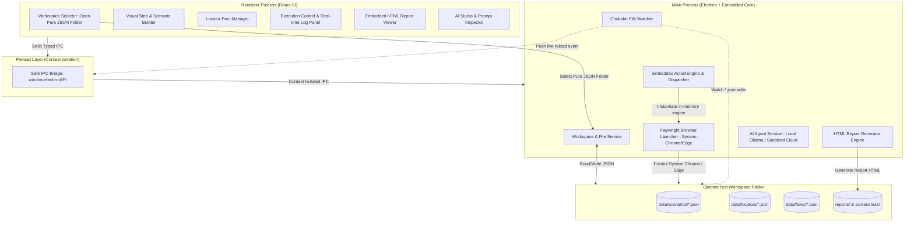

# Architecture & System Design: Playwright Embedded Studio

## 1. Executive Summary & Core Concept

**Playwright Embedded Studio** is an **All-in-One Standalone Desktop Application (Zero-Prerequisite Installer)**. 

The application encapsulates the entire test execution engine, `playwright-core`, Action Handlers, report generators, and Node.js runtime inside a single `.exe` installer. 

Consequently, a target test project folder on disk **ONLY needs to contain pure JSON test cases and locator maps** (less than 100KB in size). No `node_modules`, no `package.json`, no TypeScript compiler, and no global Node.js installation are required on the user's machine.

---

## 2. Ultra-Lightweight Workspace Model

```
┌──────────────────────────────────────────────────────────────────────────────────────────┐
│                   PLAYWRIGHT EMBEDDED STUDIO (.exe Standalone App)                       │
│                                                                                          │
│   • Embedded ActionEngine & Strategy Handlers (UI, API, Assert, Flow, Network)           │
│   • Embedded Playwright Engine (`playwright-core`) + System Chrome/Edge Auto-Detect      │
│   • Embedded HTML & Allure-compatible Report Generator (Pure JS, Zero Java)              │
│   • Dual Mode: 🟢 100% Air-Gapped Local Mode  │  🤖 Privacy-Preserving AI Agent Mode     │
└────────────────────────────────────────────┬─────────────────────────────────────────────┘
                                             │ Reads & Executes Pure JSON Directly
                                             ▼
┌──────────────────────────────────────────────────────────────────────────────────────────┐
│                   TARGET TEST FOLDER (Pure JSON Test Assets - Only ~50 KB)               │
│                                                                                          │
│   ├── data/                                                                              │
│   │   ├── scenarios/         ──► [Low-Code Test Suites & Cases (*.json)]                 │
│   │   ├── locators/          ──► [Page Object Element Repositories (*.json)]             │
│   │   ├── flows/             ──► [Optional: Reusable Sub-Flows (*.json)]                 │
│   │   └── datasets/          ──► [Optional: Data-Driven CSV/JSON tables]                 │
│   └── .env                   ──► [Optional: Base URLs & credentials]                     │
│                                                                                          │
│   ❌ NO node_modules       ❌ NO package.json       ❌ NO TypeScript compiler            │
└──────────────────────────────────────────────────────────────────────────────────────────┘
```

---

## 3. High-Level Architecture & Process Flow



---

## 4. Dual Operating Modes

```
                             MODE SELECTOR
                                   │
         ┌─────────────────────────┴─────────────────────────┐
         ▼                                                   ▼
┌─────────────────────────────────┐         ┌─────────────────────────────────┐
│     🟢 LOCAL MODE (Air-Gapped)  │         │      🤖 AI AGENT MODE (Smart)   │
├─────────────────────────────────┤         ├─────────────────────────────────┤
│ • 100% Offline & Deterministic  │         │ • Local LLM: Ollama (100% Local)│
│ • Zero outbound HTTP requests   │         │ • Cloud LLM: OpenAI/Claude with │
│ • Embedded ActionEngine         │         │   Automatic PII & Token Masking │
│ • Direct Chrome/Edge execution  │         │ • AI Locator Self-Healing       │
│ • Embedded HTML reports         │         │ • AI Failure Root-Cause Analysis│
└─────────────────────────────────┘         └─────────────────────────────────┘
```

---

## 5. Technology Stack (Zero-Dependency for End Users)

| Layer | Component | Technology Selection | User Impact |
| :--- | :--- | :--- | :--- |
| **Packaging & Shell** | Desktop Framework | **Electron (v31+) + TypeScript** | Bundles Node.js runtime inside `.exe`. User does not need Node.js. |
| **Automation Engine** | Browser Driver | **`playwright-core`** | Controls system Google Chrome or Microsoft Edge directly (`channel: 'chrome'`). |
| **Execution Core** | In-Memory Engine | **ActionEngine + Handlers** | Compiled inside App. Directly executes JSON scenarios without CLI scripts. |
| **Frontend UI** | Web Framework | **React 18 + Vite + Tailwind** | Fast, responsive, dark-mode native interface. |
| **Code / JSON Editor**| Embedded Editor | **Monaco Editor (VS Code core)** | Direct visual editing and syntax validation for JSON test suites. |
| **Reporting** | Embedded Reporter | **Playwright HTML Reporter (Pure JS)**| Generates standalone interactive HTML reports without requiring Java. |
| **Local AI Engine** | Offline LLMs | **Ollama Client SDK** | Connects to local models (`qwen2.5-coder`) for 100% air-gapped AI. |

---

## 6. IPC (Inter-Process Communication) Contract

```typescript
export interface IElectronAPI {
  workspace: {
    selectFolder: () => Promise<{ canceled: boolean; path?: string }>;
    getRecent: () => Promise<string[]>;
    getActive: () => Promise<string | null>;
  };
  scenarios: {
    list: () => Promise<IScenarioFileMeta[]>;
    read: (fileName: string) => Promise<IScenario>;
    save: (fileName: string, data: IScenario) => Promise<{ success: boolean }>;
    delete: (fileName: string) => Promise<{ success: boolean }>;
  };
  locators: {
    list: () => Promise<string[]>;
    read: (fileName: string) => Promise<ILocatorStore>;
    save: (fileName: string, data: ILocatorStore) => Promise<{ success: boolean }>;
  };
  runner: {
    executeScenario: (options: IEmbeddedRunOptions) => Promise<{ runId: string }>;
    stop: (runId: string) => Promise<boolean>;
    onStepProgress: (callback: (progress: IStepProgress) => void) => () => void;
    onRunFinished: (callback: (summary: ITestRunSummary) => void) => () => void;
  };
  ai: {
    healLocator: (req: IHealRequest) => Promise<IHealResponse>;
    analyzeFailure: (req: IFailureAnalysisReq) => Promise<string>;
    generateScenario: (prompt: string) => Promise<IScenario>;
  };
}
```
