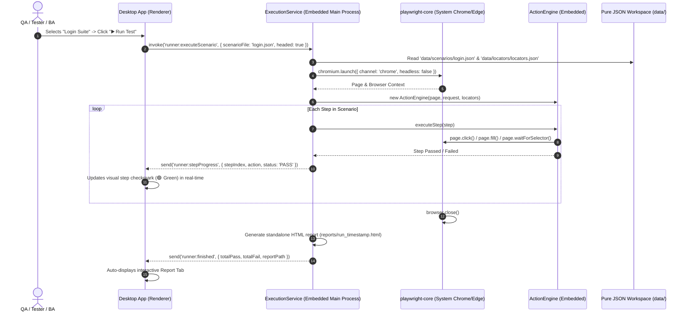

# Phase 3: Direct In-Memory Test Execution & Live Reporting

## 1. Objectives & Scope

Phase 3 implements the **Embedded Execution Engine (`execution-service.ts`)** and **Pure JavaScript Reporting Engine**. 

Instead of spawning external CLI processes, the Desktop App uses its bundled `playwright-core` and embedded `ActionEngine` to launch the user's local Chrome/Edge browser, execute pure JSON test scenarios in-memory, stream live step-by-step progress to the UI, and generate standalone HTML reports.

- **Total Estimated Effort**: 3 – 4 Days (1 Senior SDET / Electron Developer)
- **Prerequisites**: Phases 1 & 2 complete.

---

## 2. In-Memory Execution Architecture



---

## 3. Detailed Tasks & Specifications

### Task 3.1: Embedded Execution Service (`execution-service.ts`)
- **Objective**: Execute JSON scenarios directly in-memory using `playwright-core`.
- **Key Features**:
  - Automatically detects system Google Chrome (`channel: 'chrome'`) or Microsoft Edge (`channel: 'msedge'`) on Windows/macOS.
  - Instantiates `ActionEngine` for each test case, passing in locators and DDT data rows.
  - Supports Headed (visible browser) and Headless modes.
  - Execution controls: `runScenario()`, `runSelectedTests()`, `abortRun()`.
- **Acceptance Criteria**:
  - Clicking "Run Test" launches Google Chrome on the user's machine and executes all actions declared in the JSON file without any CLI dependencies.

### Task 3.2: Live Step-by-Step Execution Monitor
- **Objective**: Rich, visual progress tracking in the UI instead of raw command-line text.
- **Key Features**:
  - Displays real-time step cards with status indicators (⏳ Running, 🟢 Passed, 🔴 Failed, ⚠️ Healed by AI).
  - Shows execution duration per step and elapsed test time.
  - Live screenshot capture on step failure.
- **Acceptance Criteria**:
  - Users can visually follow test execution in the app as each action is performed on screen.

### Task 3.3: Pure JS HTML Report Generator (`report-service.ts`)
- **Objective**: Generate rich, standalone HTML test reports without requiring Java or external Allure binaries.
- **Key Features**:
  - Builds an interactive single-file HTML report saved into `<workspace>/reports/index.html`.
  - Embeds pie charts (Pass/Fail rates), execution timelines, step details, and base64 failure screenshots.
  - Renders directly in the "Reports" tab within the Desktop App.
- **Acceptance Criteria**:
  - Report generates in less than 500ms post-run and displays offline without internet connection.

### Task 3.4: Failed Step Screenshot & Error Inspector
- **Objective**: Instant visual debugging for failed assertions.
- **Key Features**:
  - In-app screenshot preview modal with error stack trace and DOM failure explanation.
  - 1-click "Trigger AI Root-Cause Analysis" button.

---

## 4. Implementation Code Blueprint

### `execution-service.ts` (Core Logic Snippet)
```typescript
import { chromium, Browser, Page } from 'playwright-core';
import { EventEmitter } from 'events';
import { ActionEngine } from '../engine/ActionEngine';
import { IScenario, ITestCase, IStep } from '../engine/types';

export class ExecutionService extends EventEmitter {
  private activeBrowser: Browser | null = null;
  private isAborted: boolean = false;

  async executeSuite(scenario: IScenario, locators: any, headed: boolean = true): Promise<void> {
    this.isAborted = false;
    
    // Launch installed Chrome or Edge
    this.activeBrowser = await chromium.launch({
      channel: 'chrome',
      headless: !headed,
      slowMo: 100, // Smooth human-visible execution
    });

    const context = await this.activeBrowser.newContext();
    const page = await context.newPage();

    for (const testCase of scenario.testCases) {
      if (this.isAborted) break;

      const engine = new ActionEngine(page, context.request, locators);
      
      for (const [index, step] of testCase.steps.entries()) {
        if (this.isAborted) break;

        this.emit('stepProgress', { testId: testCase.testId, stepIndex: index, status: 'RUNNING' });
        try {
          await engine.executeStep(step);
          this.emit('stepProgress', { testId: testCase.testId, stepIndex: index, status: 'PASSED' });
        } catch (error: any) {
          const screenshotBuffer = await page.screenshot();
          this.emit('stepProgress', {
            testId: testCase.testId,
            stepIndex: index,
            status: 'FAILED',
            error: error.message,
            screenshot: screenshotBuffer.toString('base64'),
          });
          break; // Stop remaining steps of this test case
        }
      }
    }

    await this.activeBrowser.close();
    this.activeBrowser = null;
    this.emit('runFinished');
  }

  abort(): void {
    this.isAborted = true;
    this.activeBrowser?.close();
  }
}
```

---

## 5. Verification & Testing Plan

1. **In-Memory Execution Verification**:
   - Open a folder with pure JSON test cases -> Click Run -> Verify Google Chrome opens and performs clicks/fills.
2. **Report Generation Verification**:
   - Verify `reports/index.html` is generated in the workspace and displays accurately in the embedded report viewer.
