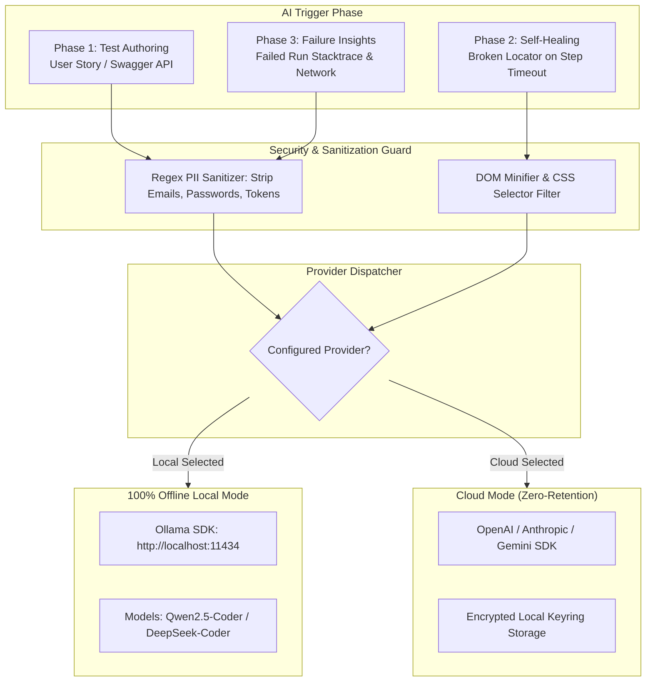

# Phase 4: AI Agent Hub (Privacy-Preserving & Dual Provider)

## 1. Objectives & Scope

Phase 4 introduces the **AI Agent Hub** to the desktop application. Designed around privacy and security, it enables intelligent features across test authoring, self-healing, and failure diagnostics. 

It supports **100% Local Offline LLMs (via Ollama)** and **Cloud LLMs (OpenAI/Anthropic/Gemini)** equipped with an automatic **PII & Sensitive Data Sanitization Layer**.

- **Total Estimated Effort**: 4 – 5 Days (1 Senior AI/Fullstack Engineer)
- **Prerequisites**: Phases 1, 2, & 3 complete.

---

## 2. Privacy-First AI Architecture



---

## 3. Detailed Tasks & Specifications

### Task 4.1: App Configuration & Mode Switcher (`.app-config.json`)
- **Objective**: Manage application modes, execution defaults, and AI settings.
- **Key Features**:
  - Global UI Toggle: `[ 🟢 LOCAL MODE ]` vs `[ 🤖 AI AGENT MODE ]`.
  - Config Schema (`.app-config.json`):
    ```json
    {
      "mode": "local",
      "ai": {
        "provider": "ollama",
        "ollamaUrl": "http://localhost:11434",
        "model": "qwen2.5-coder:7b",
        "cloudApiKey": "",
        "autoHealingEnabled": true,
        "sanitizePII": true
      }
    }
    ```
- **Acceptance Criteria**:
  - When in `Local Mode`, all AI network triggers are disabled or restricted strictly to `localhost:11434`.

### Task 4.2: Local LLM Engine (Ollama Adapter)
- **Objective**: Direct integration with Ollama for zero-leak offline AI intelligence.
- **Key Features**:
  - Auto-discovers local models via `GET http://localhost:11434/api/tags`.
  - Model status badge in UI header (Online / Offline / Model Name).
  - Streamed response handling for low-latency feedback.
- **Acceptance Criteria**:
  - Functions completely with network adapters disabled (Air-gapped verification).

### Task 4.3: PII & Sensitive Data Sanitizer Middleware
- **Objective**: Prevent test credentials, authorization tokens, and user data from being exposed to LLMs.
- **Key Features**:
  - Strips Bearer tokens, cookies, passwords, credit card patterns, and emails before prompt submission.
  - Sanitizes DOM snapshots: Strips `<script>`, `<style>`, `<svg>`, inline base64 images, keeping only interactive DOM hierarchy.
- **Acceptance Criteria**:
  - Prompt inspector shows sanitized payload before any external API dispatch.

### Task 4.4: AI Self-Healing Studio & Diff Review
- **Objective**: Visual oversight and audit log for runtime locator auto-healing.
- **Key Features**:
  - Integrates with `utils/core/AutoHealer.ts`.
  - **Audit Log Panel**: Displays timestamp, page, element name, broken selector, suggested replacement, confidence score, and DOM context.
  - **1-Click Apply**: Automatically updates `data/locators/*.json` on disk.
- **Acceptance Criteria**:
  - Self-healing repairs the locator on disk and displays a notification in the UI log.

### Task 4.5: Authoring & Root-Cause Failure Analysis Agents
- **Objective**: Multi-phase intelligent assistance for QA engineers.
- **Key Features**:
  - **Authoring Agent**: Converts natural language prompts (e.g., *"Create checkout test with standard user, fill address, verify finish button"*) into validated JSON scenario files matching `scenario-schema.json`.
  - **Root-Cause Analysis Agent**: Evaluates failed test cases, correlating Playwright error logs, network 4xx/5xx requests, and screenshots to explain *why* the test failed in plain English.
- **Acceptance Criteria**:
  - Authoring agent generates 100% syntactically valid JSON scenario files.

---

## 4. Implementation Code Blueprint

### `sanitizer-service.ts` (Core Logic Snippet)
```typescript
export class SanitizerService {
  private static PII_PATTERNS = [
    { regex: /bearer\s+[A-Za-z0-9\-\._~\+\/]+=*/gi, replace: 'bearer [REDACTED_TOKEN]' },
    { regex: /[a-zA-Z0-9_.+-]+@[a-zA-Z0-9-]+\.[a-zA-Z0-9-.]+/g, replace: 'user@redacted.local' },
    { regex: /"password"\s*:\s*"[^"]+"/gi, replace: '"password": "[REDACTED_PASSWORD]"' },
    { regex: /\b\d{4}[ -]?\d{4}[ -]?\d{4}[ -]?\d{4}\b/g, replace: '[REDACTED_CARD]' },
  ];

  static sanitizePrompt(prompt: string): string {
    let sanitized = prompt;
    for (const pattern of this.PII_PATTERNS) {
      sanitized = sanitized.replace(pattern.regex, pattern.replace);
    }
    return sanitized;
  }

  static cleanDomSnapshot(html: string): string {
    return html
      .replace(/<script\b[^<]*(?:(?!<\/script>)<[^<]*)*<\/script>/gi, '')
      .replace(/<style\b[^<]*(?:(?!<\/style>)<[^<]*)*<\/style>/gi, '')
      .replace(/<svg\b[^<]*(?:(?!<\/svg>)<[^<]*)*<\/svg>/gi, '<svg />')
      .replace(/<!--[\s\S]*?-->/g, '');
  }
}
```

---

## 5. Verification & Testing Plan

1. **Sanitization Tests**:
   - Verify all regex masks replace passwords, emails, and tokens accurately in prompts.
2. **Ollama Integration Test**:
   - Run local Ollama server -> Trigger scenario generation -> Verify resulting JSON passes `Ajv` schema validation.
3. **Auto-Healing End-to-End Test**:
   - Intentionally alter `loginBtn` selector in `LoginPage.json` -> Run test in AI Mode -> Confirm AutoHealer detects break, requests Ollama/OpenAI, and updates file on disk.
